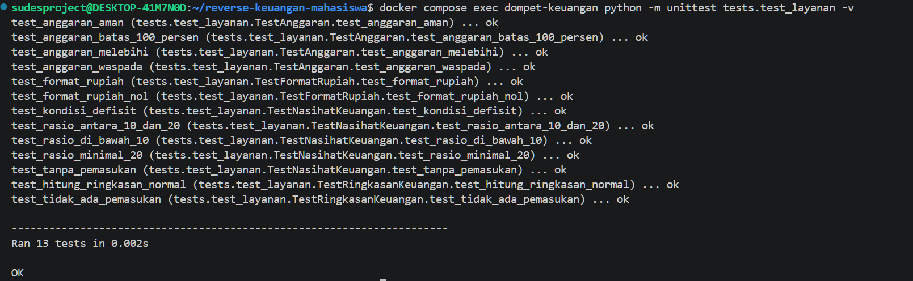
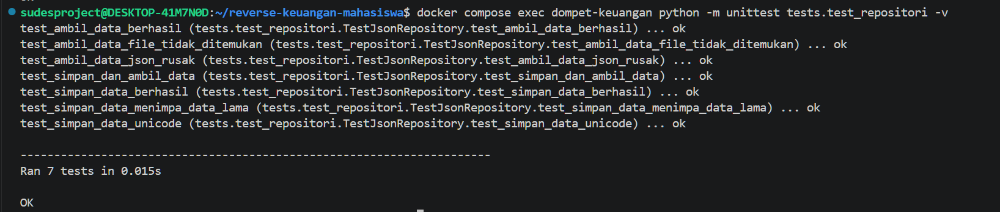
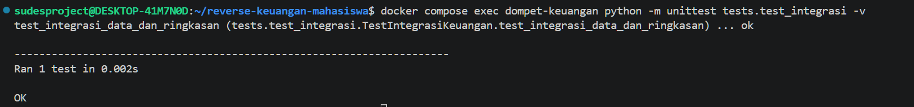

# Dompet Mahasiswa

**Tipe aplikasi:** Keuangan pribadi · **Port:** http://localhost:5004

Pencatatan pemasukan dan pengeluaran bulanan, anggaran per kategori, rasio tabungan, ekspor CSV.

> ⚠️ Aplikasi ini **sengaja dibuat monolitik**: seluruh kode (akses data JSON, aturan bisnis, validasi, HTML, dan API) bercampur di satu file `app.py`. Tugas Anda adalah memecahnya menjadi modul **tanpa mengubah perilakunya**. Panduan lengkap: [`../README.md`](../README.md).

## Menjalankan

Aplikasi ini punya `docker-compose.yml` sendiri. Jalankan dari **folder ini**:

```bash
docker compose up --build
# buka http://localhost:5004
```

Tanpa Docker: `pip install -r requirements.txt`, lalu `python app.py` (port 5000).

## Cek Cepat Sebelum & Sesudah Dimodularisasi

Jalankan perintah berikut **sebelum** mengubah kode, catat hasilnya, lalu ulangi **sesudah** modularisasi. Hasilnya harus sama.

```bash
curl -s 'localhost:5004/api/ringkasan?bulan=2026-10'
```
Hasil: `pemasukan` 3750000, `pengeluaran` 2825000, `rasio_tabungan` 24.7, `saldo_total` 1025000

```bash
curl -s 'localhost:5004/api/anggaran?bulan=2026-09'
```
Hasil: Hiburan 133.3% `melebihi`, Makan 86.7% `waspada`

Data contoh ikut berubah setiap ada transaksi. Kembalikan dengan `git checkout -- data.json` sebelum mengecek ulang.

## Aturan Bisnis

Semua aturan ini saat ini tertulis **langsung di dalam fungsi route** (sebagian tertulis lebih dari sekali).

1. Validasi transaksi: tanggal format `YYYY-MM-DD`, jumlah bilangan bulat > 0, kategori harus cocok dengan jenis (pemasukan/pengeluaran)
2. ID transaksi `Tnnn` = nomor terbesar + 1
3. Ringkasan bulanan: pemasukan, pengeluaran, selisih
4. **Rasio tabungan** = selisih ÷ pemasukan × 100 (1 desimal)
5. Saldo total dari seluruh transaksi
6. Komposisi pengeluaran per kategori (persen), urut terbesar
7. Status anggaran: **aman** (< 80%), **waspada** (80–100%), **melebihi** (> 100%)
8. Nasihat keuangan berdasarkan rasio tabungan (< 0, < 10%, < 20%, ≥ 20%)
9. Ekspor CSV berpemisah `;` (tanda `;` di catatan diganti `,`)

## Daftar Route

| Method | URL | Keterangan |
|--------|-----|------------|
| GET | `/?bulan=YYYY-MM` | Dasbor bulanan + form |
| POST | `/tambah` | Simpan transaksi dari form |
| GET | `/export.csv?bulan=` | Unduh CSV |
| GET | `/api/transaksi?bulan=` | Daftar transaksi |
| POST | `/api/transaksi` | `{tanggal, jenis, kategori, jumlah, catatan?}` |
| POST | `/api/hapus` | `{id}` |
| GET | `/api/ringkasan?bulan=` | Ringkasan bulanan |
| GET | `/api/kategori?bulan=` | Komposisi pengeluaran |
| GET | `/api/anggaran?bulan=` | Status anggaran |

## File

| File | Isi |


|------|-----|
| `app.py` | Seluruh aplikasi (monolitik) |
| `data.json` | Data contoh (berubah setiap ada transaksi) |
| `Dockerfile`, `requirements.txt` | Image Python 3.12 + Flask |
| `docker-compose.yml` | Menjalankan aplikasi ini di port 5004; folder di-mount ke container sehingga perubahan kode langsung terbaca |


# Dokumentasi Pengujian

## 1. Unit Testing


## screenshot hasil test layanan


## 2. Repository Testing


## screenshot hasil test repositori


## 3. Integration Testing


## screenshot hasil test integrasi


## 4. Simulasi Unit Testing FAIL


